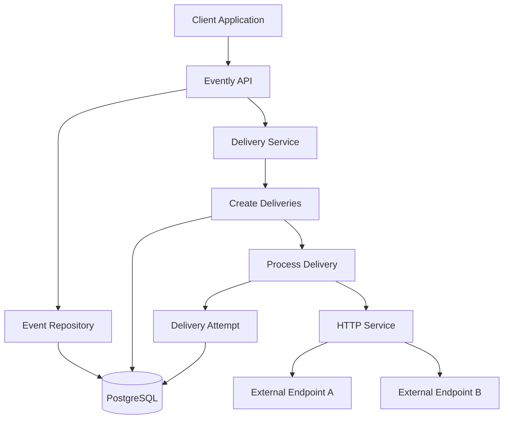
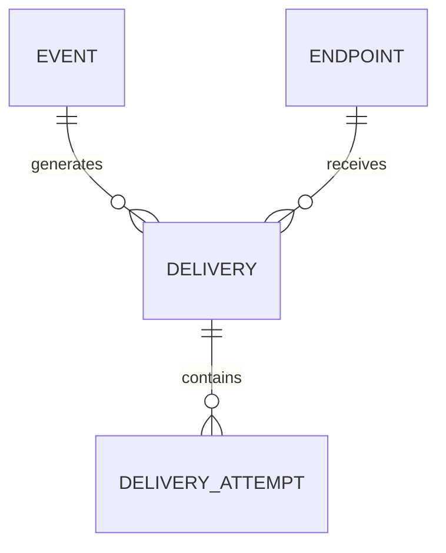

# Evently

Evently is a webhook delivery service designed to simplify event-driven communication between applications.

It acts as an intermediary between event producers and external services, accepting events, managing delivery destinations, dispatching HTTP requests, and tracking delivery results.

The project focuses on reliable event delivery, backend architecture, database consistency, and distributed system fundamentals.

## Overview

Modern applications often need to notify external systems when something happens, such as a completed payment, a new user registration, or an updated order.

Instead of implementing webhook delivery logic independently in every application, Evently provides a centralized service responsible for delivering events and tracking their outcomes.

## Features

### Implemented

- Event ingestion through a REST API
- Webhook endpoint registration
- JSON event payloads
- Delivery to multiple registered endpoints
- HTTP webhook dispatching
- Delivery status tracking
- Delivery attempt history
- HTTP error and network exception handling
- PostgreSQL persistence
- Database migrations with Alembic

### Planned

- Automatic delivery retries
- Exponential backoff
- Event-based endpoint subscriptions
- Background delivery workers
- Asynchronous HTTP requests
- Idempotency and duplicate detection
- Webhook signature verification
- SSRF protection
- Redis integration
- Task queues
- Dead letter queue
- API authentication
- Automated testing
- Logging, metrics, and monitoring

## Technology Stack

| Technology | Purpose |
|---|---|
| Python | Core application language |
| FastAPI | REST API |
| PostgreSQL | Persistent data storage |
| SQLAlchemy 2.0 | ORM and database access |
| Alembic | Database migrations |
| Pydantic | Data validation |
| HTTPX | Outgoing HTTP requests |
| Docker Compose | Local database infrastructure |
| uv | Dependency management |

## Architecture



Evently separates event ingestion, database operations, delivery orchestration, and HTTP communication into independent components.

## Delivery Lifecycle

1. A client submits an event through the REST API.
2. Evently validates and stores the event.
3. The delivery service retrieves registered endpoints.
4. A separate delivery record is created for each endpoint.
5. The HTTP service sends the event to each destination.
6. The delivery status is updated.
7. The result of each attempt is stored in PostgreSQL.

Each delivery is tracked independently, allowing one event to have multiple delivery outcomes.

## Data Model



### Event

Represents an incoming event.

- `id`
- `event_type`
- `data`
- `created_at`

### Endpoint

Represents a registered webhook destination.

- `id`
- `name`
- `url`
- `created_at`

### Delivery

Represents the delivery of a specific event to a specific endpoint.

- `id`
- `event_id`
- `endpoint_id`
- `status`
- `created_at`
- `updated_at`

### DeliveryAttempt

Represents an individual HTTP delivery attempt.

- `id`
- `delivery_id`
- `attempt_number`
- `response_status`
- `response_body`
- `error_message`
- `created_at`

## Delivery Statuses

| Status | Description |
|---|---|
| `pending` | Delivery has been created but not completed |
| `success` | Event has been successfully delivered |
| `failed` | Delivery attempt has failed |

## API Reference

| Method | Endpoint | Description |
|---|---|---|
| POST | `/endpoints` | Register a webhook endpoint |
| POST | `/events` | Create and dispatch an event |
| GET | `/events` | Retrieve all events |
| GET | `/events/{event_id}` | Retrieve a specific event |

Interactive API documentation is available at `/docs`.

### Register an Endpoint

```bash
curl -X POST http://localhost:8000/endpoints \
  -H "Content-Type: application/json" \
  -d '{
    "name": "Payment Service",
    "url": "https://httpbin.org/post"
  }'
```

### Publish